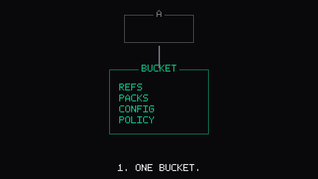
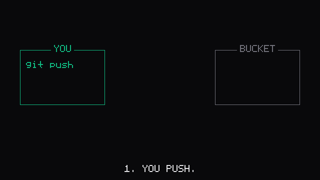
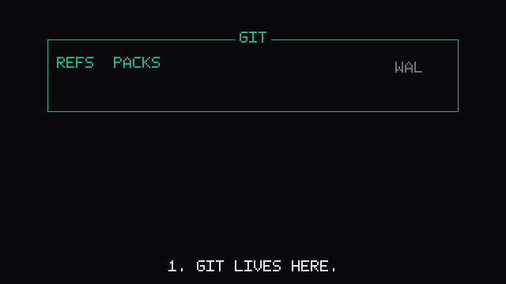

<h1 align="center">spindle</h1>

<p align="center"><b>A complete git host in Go.</b><br>
Git over smart HTTP and SSH, LFS, bundles, issues, pull requests, CI, an OCI registry, static sites,<br>
a JSON API and a web UI — where the object store is the only database.</p>

<p align="center">Instances are disposable: wipe one and you lose nothing but warmth.</p>

<p align="center">
  <code>Go 1.27</code> · <code>MIT</code> · <code>single binary</code> · <code>OIDC required</code> ·
  <code>object store is the database</code> · <code>Linux/amd64 image, arm64 cross-build</code>
</p>

<p align="center">
  
</p>

<p align="center"><sub><b>The object store is the repository.</b> Refs, packs, config, policy, issues, PRs and CI runs are
objects in one bucket; disk and memory are caches. No SQL, no Redis, no queue, no search cluster.</sub></p>

<p align="center">
   
</p>

<p align="center"><sub>Left: a push is answered only after the bucket does. Right: issues, PRs, reviews and checks ride
beside git, and the write-ahead log stays git-only.</sub></p>

## Why spindle

**The object store is the only database.** Refs, packs, config, policy, issues, pull requests, reviews, checks,
releases, CI runs and notifications are object families under one bucket prefix, read through a single
`ObjectStore` contract. The manifest CAS (`repos/<owner>/<repo>/manifest.pb`) is the only commit point, so a
push is never acknowledged before the bucket has it. Wipe every instance and the repositories are still there.

**It speaks walgit's bucket.** The key layout, protobuf field numbers and wire encoding, JSON file shapes and git
wire behaviour follow [walgit](https://github.com/tobi/walgit)'s formats. That compatibility is a test, not an
intention: golden fixtures in the package `testdata/` directories fail the build if either side drifts.

**One binary, every role.** `serve` (no subcommand), `maintain` (checkpoints, bundles, compaction, fsck/repair,
sweepers), `events` (the WAL → webhook bridge) and `runner serve` (Threads CI) are the same binary. Nothing else
to install, schedule or keep in sync.

**A complete surface, not a git server with a UI bolted on.**

| | |
|---|---|
| **Git** | smart HTTP v0/v2, SSH, Git LFS, bundle-uri, auto-create on push, push policy (`protect`/`history`/`size`), source archives |
| **Collaboration** | issues, pull requests, line-anchored reviews, checks and required-check gates, notifications, releases and assets, stars, forks, import, mirrors, moderation |
| **CI** | Threads: workflows in `.spindle/workflows/`, container jobs with services, `needs:`, matrices and concurrency groups, checks that gate merges, SSE logs, scoped job tokens, deployment approvals |
| **Registry** | an OCI registry per repository at `/v2`: `docker push <host>/<owner>/<repo>:1.4.2` — pull uses the read gate, push is the same gate as `git push` |
| **Static sites** | a repository's committed tree served read-only at `<site-host>/{owner}/{repo}/…` by a second, cookie-less listener: no build step, Pages-style resolution, public repositories only (`[static_sites]` host, per-repo `[static_site]`) |
| **Search** | `git grep` at a resolved commit on the serving copy (no index): code search in one repository or across an owner's readable repositories, plus issue/PR titles, labels and bodies with moderation redaction — through `/{o}/{r}/api/search`, `/api/v1/search`, both search pages and `spindle search` |
| **API and UI** | a JSON API with SSE, the dependency-free `repos.js` SDK, and a server-rendered htmx UI |

**Administration is OIDC and nothing else.** Any OpenID Connect issuer; your identity provider's groups decide who
administers the instance. No local accounts, no passwords, no email/domain admin rule, no static-token admin: you are
an administrator exactly when your verified `groups_claim` intersects `server.auth.admin_groups` (default
`spindle-admin`). A `wgt_` access token minted at `/_auth/tokens` acts as the user who minted it — the verified groups ride
the signed token, so it re-derives the same admin verdict — while `[[server.auth.tokens]]` rows are instance
machine credentials for git and the API and never administer. There are no admin commands in the CLI; admin
actions happen in the Administration area (or the API, with a user token). A config that cannot satisfy this
boots **restricted**, never open.

**Disposable by construction, and measured.** Kill an instance, wipe a cache, run a second reader: the bucket is
unchanged and a fresh process serves the same repositories immediately — which is what makes upgrades, restores and
horizontal reads cheap. A push with the whole collaboration layer mounted costs 8 store operations cold and 9 warm,
touching zero collaboration keys; a warm-refs clone is 1 round trip. Each claim has a committed harness in
[docs/EVIDENCE.md](docs/EVIDENCE.md).

## Try it in two minutes

### One binary

```sh
make build      # UI assets (app.css, ui.js, repos.js) + the binary; web/dist is embedded
./spindle       # zero config: 0.0.0.0:8080, filesystem store under the data dir
```

Open **http://localhost:8080/admin**. With no config the boot is **restricted**, not open: only the
Administration area, its POSTs, the setup API (`/api/v1/setup*`), the health endpoints and the embedded
static assets (`/_ui/*`, `/services/public/*`) answer — no setup token, no anonymous admin. The first-run card takes the issuer,
the admission allowlist (an email domain or address), the OAuth client id and secret, a session secret and the admin
group; **Save** writes `<data-dir>/spindle.toml` without contacting the identity provider, then you restart. A
restricted `/readyz` is 200 with `status: restricted`, so a health-gated ingress routes it; the walkthrough, redirect
URI and machine tokens are in [docs/OPERATIONS.md](docs/OPERATIONS.md). No identity provider handy? The dev IdP in
[Develop](#develop) is one command.

### Docker Compose, prebuilt image

```yaml
services:
  spindle:
    image: ghcr.io/crueber/spindle:latest   # :main, vX.Y.Z, sha-<sha>
    ports: ["8080:8080", "2222:2222"]       # HTTP, SSH
    environment:
      SPINDLE__SERVER__SSH__LISTEN: 0.0.0.0:2222
    volumes: [spindle-data:/var/lib/spindle]
    restart: unless-stopped

volumes:
  spindle-data: {}
```

```sh
docker compose up -d        # update later with: docker compose pull && docker compose up -d
```

Same restricted first boot at **http://localhost:8080/admin**; after the save, restart with **Administration →
Maintenance → Restart** or `docker compose restart`. Git over SSH is published on 2222: add a public key on the
**/keys** page, then `git clone ssh://git@localhost:2222/<owner>/<repo>.git`. The host key generates into the data
volume, so clients pin it across restarts.

### Push something

On a first-run instance, repositories auto-create on push:

```sh
mkdir demo && cd demo && git init -b main
echo "# demo" > README.md && git add -A && git commit -m "hi"
git remote add origin http://localhost:8080/you/demo.git
git push -u origin main          # username: you; password: a wgt_ token from /_auth/tokens
```

Browse it at **http://localhost:8080/you/demo**. With `server.auth.anonymous_read` on (the default), public
repositories clone and browse without a session.

## Deploy

- **Prebuilt image.** `ghcr.io/crueber/spindle:latest` (`:main`, `vX.Y.Z`, `sha-<sha>`), or `make image` locally:
  three stages, Alpine + git, nonroot, web assets embedded.
- **Two compose shapes.** [`compose.standalone.yml`](compose.standalone.yml) is spindle alone on a filesystem volume;
  [`compose.yaml`](compose.yaml) is spindle beside rustfs for the S3 store (`SPINDLE__STORE__S3__*`, with
  `force_path_style = true` for rustfs/MinIO). Both are working examples — pin the image and set `server.public_url`.
- **TLS belongs to the proxy.** spindle serves plain HTTP/2 (h2c) and has no `server.tls.*` by design: terminate TLS
  in front, point `server.public_url` at the public origin, register `<public_url>/_auth/callback` at the IdP.
- **SSH.** Set `server.ssh.listen` (or `SPINDLE__SERVER__SSH__LISTEN=0.0.0.0:2222`) and publish the port. Keys are
  per-user on **/keys**; the host key lives in the data directory.
- **Back up the store, not the machine.** Copy `store.root` (or the S3 bucket under `store.prefix`) plus
  `<data-dir>/spindle.toml` and the SSH host key; `<cache.dir>` is expendable. `sh scripts/backup-store.sh --from
  <store> --to <archive>` snapshots a quiesced filesystem store, `scripts/restore-store.sh` restores it, S3 needs a
  point-in-time copy, and `make backup-drill` proves the round trip.
- **Upgrade with a preflight.** `spindle doctor` reads the config and a bounded bucket sample before you recreate
  anything; the checkpoint → quiesce → preflight → swap order is [docs/UPGRADE.md](docs/UPGRADE.md).

## Command line

`spindle` is one binary; with no subcommand it serves.

| | |
|---|---|
| **Operator-local** | `serve` (the default), `compact`, `bundle run/plan/compose/rm`, `repo create/list/info/policy/settings`, `access get/put`, `wal …`, `synth` and `mirror` (stubs that answer "not yet implemented"), `import`, `config check/dump`, `doctor`, `version` |
| **JSON-API clients** | `auth`, `user`, `org`, `issue`, `pr`, `release`, `checks`, `packages`, `threads`, `file`, `runner`, `api`, `completion` |

API commands take the repository as `OWNER/REPO`, `-R OWNER/REPO` or `SPINDLE_REPO`; `--server URL` (or
`SPINDLE_SERVER`) picks the host, and `--json` prints the endpoint body unchanged. `spindle auth login` stores a token
at `~/.config/spindle/auth.json` (mode 0600, never printed; `SPINDLE_CONFIG_DIR` overrides), or `SPINDLE_TOKEN`
supplies one. Exit codes: **0** success, **1** command/config/API error, **2** usage or a missing explicitly-named
config file, **3** `config check --strict` ignored overrides or a 404, **4** authentication/authorization.
`spindle help`, `<command> --help` and `completion bash|zsh|fish` cover the rest; reference:
[docs/CLI.md](docs/CLI.md).

## Develop

```sh
make build      # assets + the static binary; make web is the assets alone
make test       # Go fast tier (-short) + the headless web tests
make race-pr    # -race over the packages that own shared state (what every PR runs)
make race       # the whole fast tier under -race (main pushes)
make cover      # ≥ 95% statements, every internal/... package
make contract   # store contract: memory + filesystem (S3: make dev-store, then make contract-s3)
make sim        # fault-injection consistency proof + round-trip budgets
make e2e        # real-git end-to-end flows
make a11y       # rendered accessibility floor (headless Chromium over CDP)
make ci         # vet + tests + race + coverage + contract + sim + e2e + a11y
make image      # the OCI image
```

Go 1.27, one module, seven direct third-party dependencies — the dependency budget is law (`AGENTS.md` §1); anything
else is hand-rolled or needs a written amendment first. Pages are server-rendered Go `html/template` with vendored
htmx 2.0.4 and small vanilla-ES islands; the server renderer is the XSS boundary, so markdown, diffs and commit graphs
are escaped and sanitized in Go. Tailwind v4 (pnpm) and esbuild build the assets, and the JS tests use Node's built-in
runner. A real sign-in needs an identity provider: `go run ./internal/devtools/oidpstub` (or the `dev-idp` compose
profile) is a stdlib dev IdP that prints the `[server.auth]` block to paste at `/admin`.

Full manual: [docs/DEVELOPMENT.md](docs/DEVELOPMENT.md) · the laws and field lessons: [AGENTS.md](AGENTS.md).

## Docs

| Doc | Holds |
|---|---|
| [docs/FEATURES.md](docs/FEATURES.md) | What ships: git, collaboration, Threads CI, the OCI registry, static sites, search, the API and the UI. |
| [docs/DEPLOY.md](docs/DEPLOY.md) | Images, compose (filesystem and S3), SSH, listeners, TLS at the proxy, configuration, troubleshooting. |
| [docs/OPERATIONS.md](docs/OPERATIONS.md) | First run, OIDC, the Administration area, configuration and restart keys, tokens, runners. |
| [docs/CLI.md](docs/CLI.md) | Every command, flag, repo selector and exit code. |
| [docs/DEVELOPMENT.md](docs/DEVELOPMENT.md) | Prerequisites, build, package map, tests, CI and the publish flow. |
| [docs/threads.md](docs/threads.md) | The Threads reference: workflow keys, triggers, containers, secrets, runner flags, troubleshooting. |
| [docs/BACKUP.md](docs/BACKUP.md) | Backup and restore procedure, the mid-push caveat, RPO/RTO, post-restore checks. |
| [docs/UPGRADE.md](docs/UPGRADE.md) | Moving a running instance to a new build, including the config preflight. |
| [docs/features/](docs/features/README.md) | The collaboration layer's planning contracts and as-built records. |
| [docs/go/](docs/go/README.md) | Per-package implementation contracts; start at the overview, then concurrency. |
| [docs/style-guideline.md](docs/style-guideline.md) | The normative design language (Precision Dark) and the accessibility rules. |
| [docs/EVIDENCE.md](docs/EVIDENCE.md) | Measured performance claims, each with a committed harness and a named backend. |
| [docs/MASTER_RUST_SPEC.md](docs/MASTER_RUST_SPEC.md) | The Rust reference implementation's behaviour — normative for behaviour, not for Go structure. |
| [AGENTS.md](AGENTS.md) | The laws, the working rules and the field lessons (each one shipped a real failure). |

## Acknowledgements

**Tobi Lütke and [walgit](https://github.com/tobi/walgit).** spindle exists because walgit proved a git host could
put everything on an object store, and it is the direct inspiration for this project. The object-store design,
the bucket key layout, the protobuf wire encoding and the git wire behaviour spindle stays compatible with are
walgit's. Thank you, Tobi.

**Libraries.** A deliberately small budget — seven direct modules, and a written amendment before an eighth:
[go-chi/chi](https://github.com/go-chi/chi) (the router, core only), [BurntSushi/toml](https://github.com/BurntSushi/toml)
(config), [golang.org/x/net](https://pkg.go.dev/golang.org/x/net) (h2c and the HTML allowlist sanitizer),
[golang.org/x/crypto](https://pkg.go.dev/golang.org/x/crypto) (the SSH transport),
[dicebear-go](https://github.com/dicebear/dicebear-go) and [dicebear/styles](https://github.com/dicebear/styles)
(deterministic avatars), and [gopkg.in/yaml.v3](https://pkg.go.dev/gopkg.in/yaml.v3) (Threads workflow files only).
Everything else — S3 SigV4, the protobuf codec, JWKS/JWT verification, SSE — is hand-rolled on the standard library
by design.

**Frontend.** [htmx](https://htmx.org) (vendored, 2.0.4), [Tailwind CSS](https://tailwindcss.com) 4,
[esbuild](https://esbuild.github.io), [pnpm](https://pnpm.io), and Node's built-in test runner. No UI framework, no
client data layer, no TypeScript.

**Standards and prior art.** The git protocol (smart HTTP v0 and v2), [Git LFS](https://git-lfs.com), the
[OCI Distribution spec](https://github.com/opencontainers/distribution-spec) and OpenID Connect — plus the feature
bar set by GitHub, Gitea and Forgejo, which spindle measures itself against. No code is shared with those projects;
the debt is to their users' expectations.

## License

[MIT](LICENSE) © 2026 Christopher Rueber

> No politics allowed — see our [Code of Conduct](CODE_OF_CONDUCT.md).
