# spindle — design language proposals

Three candidate design languages for spindle's web UI, compared against the shipped UI with
real screenshots of a populated instance and full-size wireframes of the two most
representative screens.

*Prepared 2026-11-20. Current UI: `main` @ `1fa3a62` (server-rendered Go templates + htmx,
Tailwind v4, emerald-on-zinc, dark by default).*

> **DECIDED 2026-11-20 — A (“Precision Dark”) was adopted.** The normative
> instantiation lives in `docs/style-guideline.md` §1 Foundations; the
> implementation lands on the `feat/precision-dark` branch. C's per-area colour
> identity and B's reading measure were kept as ideas where they fit (the
> markdown measure is in the guideline; per-area colour was not adopted, because
> one accent that means *action* is the point of A).

> **TL;DR** — The shipped UI is competent but undifferentiated: one accent, one surface, one column,
> for every kind of content. Three directions are proposed and rendered. **Recommendation: C (Layered
> Depth)** — it is the only one where you can tell code from issues from operations without reading the
> title — with A's monospace identifiers and B's README measure folded in. If the appetite is a
> smaller change, A is the cheapest and still clearly different. B is the most beautiful and the least
> strategic. **The decision went to A** (note above): density plus monospace identifiers carried the
> product identity further than per-area colour, and it is the smallest change to ship.

---

## 1. Method

- **Real data, real pages.** A spindle instance was run locally against a filesystem store and
  seeded with a repository (`acme/demo`: a short commit history, tag `v0.1.0`, branches `main` and
  `feature/telemetry2`, a Go source tree and two markdown docs) plus four labelled issues.
  Every screenshot below is a real render at 1440×900 (two at 390×844), not a mock.
- **Same content in every proposal.** Each wireframe renders the same repository, the same
  five file rows, the same README and the same four issues, so the comparison isolates the
  design language rather than the content. The current-UI screenshots show the live instance those
  wireframes are modelled on; the mocks use a slightly longer history and higher issue numbers to
  stay legible at wireframe size.
- **Two screens carry the comparison:** the repository *Code* page (the densest, most-used
  surface) and the *Issues* list (the most content-shaped collaboration surface). The other
  current screenshots show the surrounding chrome the language has to cover.

### Why this exercise at all

The shipped UI is competent and consistent, but it is *neutral*: every page is the same
zinc-on-zinc column, the same rounded card, the same emerald link colour. Nothing on screen
says "code" versus "issues" versus "operations"; nothing rewards a power user; the file
table omits the commit message and the page offers no branch selector, no "go to file", no
repository "About" panel. It looks like a well-built admin page, not like a tool someone
chooses over the alternative.

Three different answers to that, each internally coherent:

| | Direction | One-line thesis |
|---|---|---|
| **A** | Precision Dark | Density and keyboard speed; a developer tool that respects your time. |
| **B** | Soft Light | Editorial calm; make reading and scanning pleasant above all. |
| **C** | Layered Depth | Spatial navigation with per-area colour identity; an application, not a document. |

---

## 2. Current UI (baseline)

### 2.1 Shipped tokens

| Role | Value |
|---|---|
| Canvas | `zinc-950` (`#09090b`) dark / white light |
| Surface | `zinc-900/70` with `zinc-800` border, `rounded-lg`, `shadow-sm` |
| Text | `zinc-100` primary, `zinc-400` muted |
| Accent | `emerald-400/500` (brand, links, primary buttons, focus ring) |
| Type | system sans; monospace only for SHAs, refs, code |
| Rhythm | 4 px base, 24 px gutters, single ~1120 px column |

The accent is used for *everything interactive* — brand, nav hover, links, primary button,
selected tab underline, file names — so it carries no meaning beyond "clickable".

### 2.2 Screens

The baseline captures in this and the following section were taken before the
project's current naming; the §8 after-captures are the shipped app.

All at 1440×900 unless noted; the instance is `acme/demo` with four open issues.

| Page | What it is |
|---|---|
| 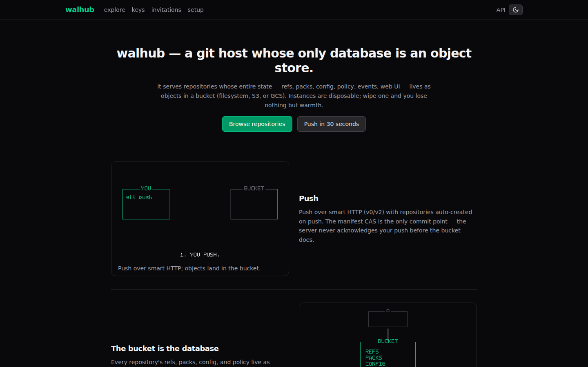 | **Landing.** The "bucket is the database" argument as a hero plus a three-step explainer. |
| 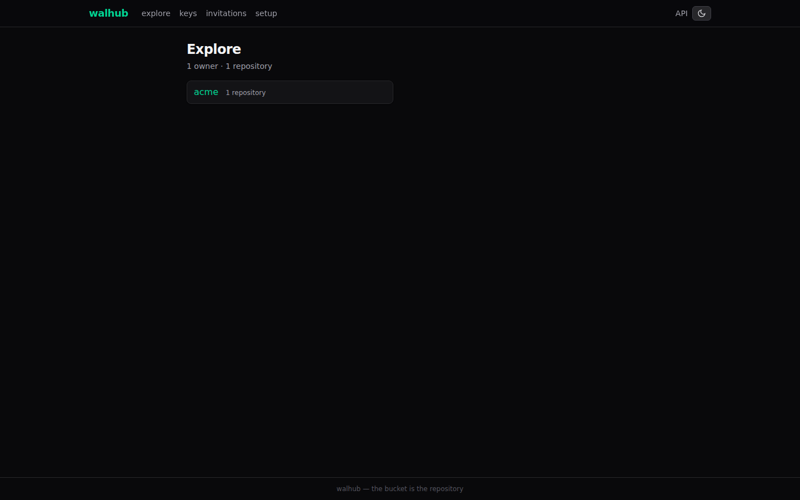 | **Explore.** Owner list (one owner, one repository) — a single small card in an empty canvas. |
| 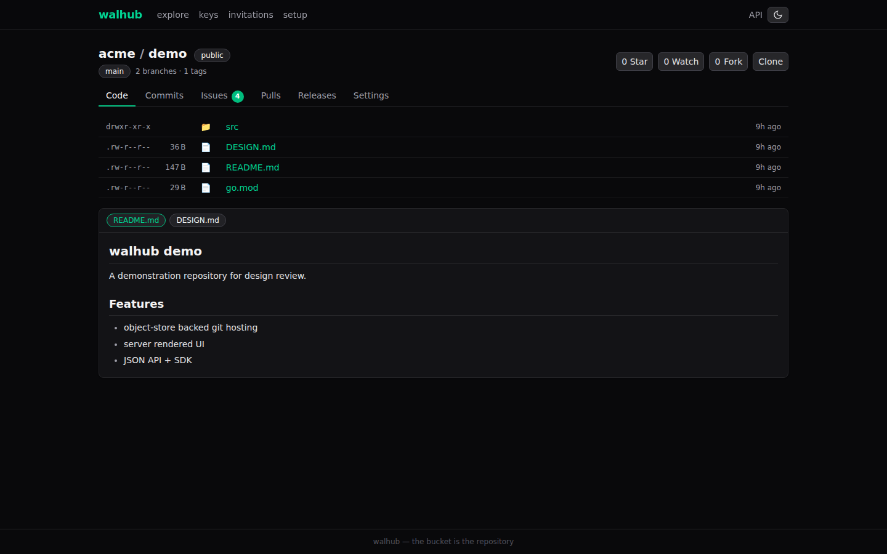 | **Repository → Code.** File table, README panel, star/watch/fork/clone. |
| 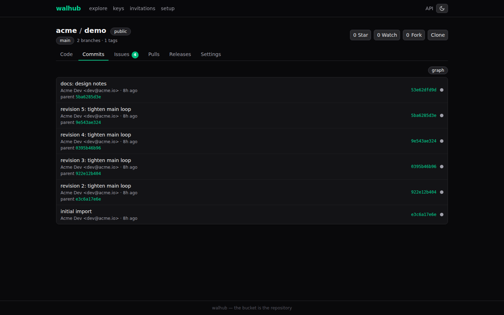 | **Repository → Commits.** Linear history with author, relative age, short SHA, graph toggle. |
| 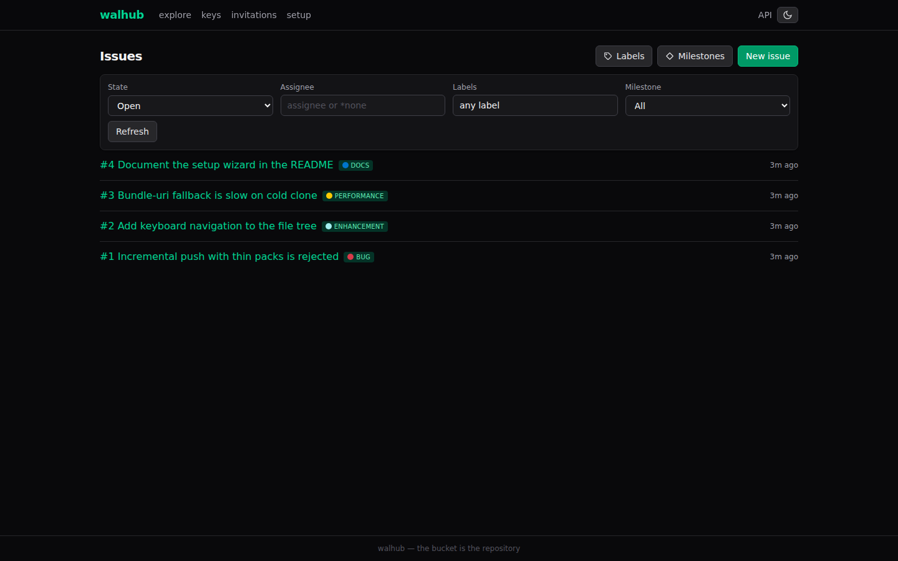 | **Repository → Issues.** Filter card (four selects) and the issue rows. |
| 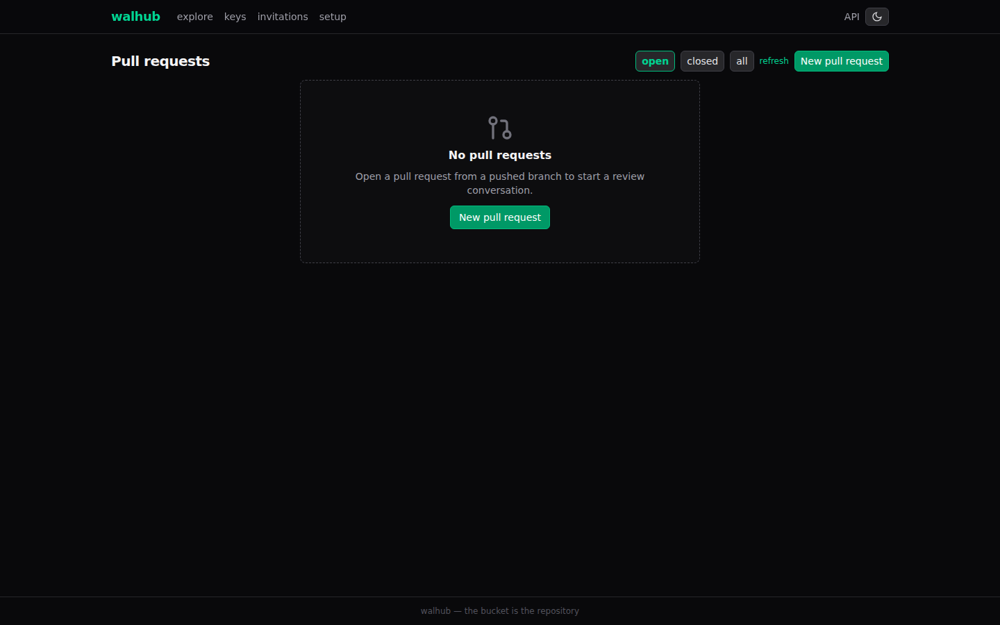 | **Repository → Pull requests.** Empty state, open/closed/all segmented links. |
| 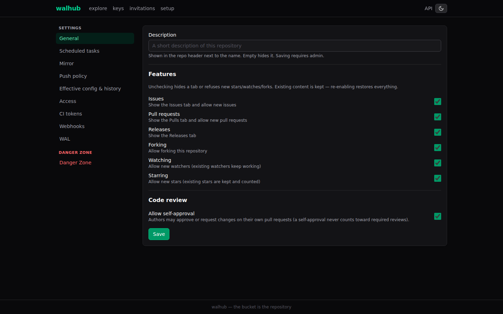 | **Repository → Settings → General.** Vertical section nav, feature checkboxes, code-review policy. |
| 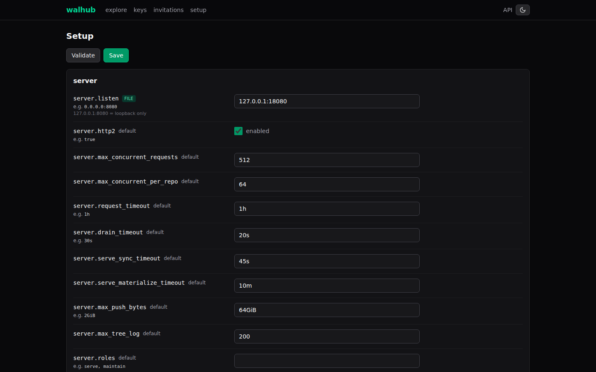 | **Setup.** The whole config schema as one long form, grouped by section. |
| 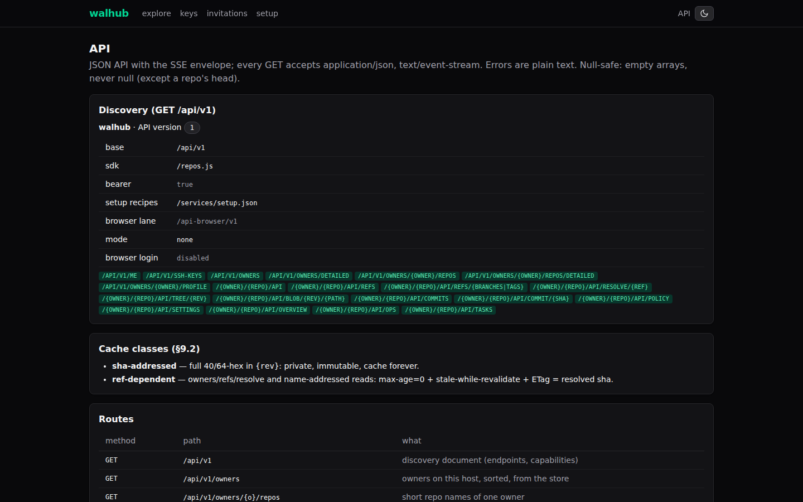 | **API reference.** The endpoint table the SDK is generated from. |
| 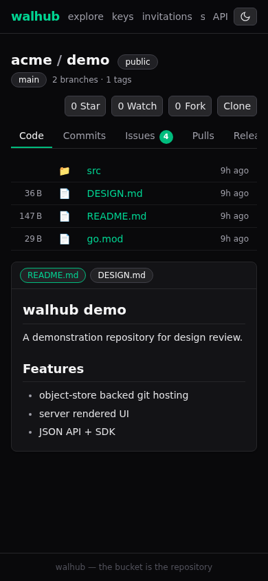 | **Repository code at 390 px.** Header nav and repo tabs scroll internally; no page-level horizontal pan (`scrollWidth == clientWidth == 390`, measured). |
| 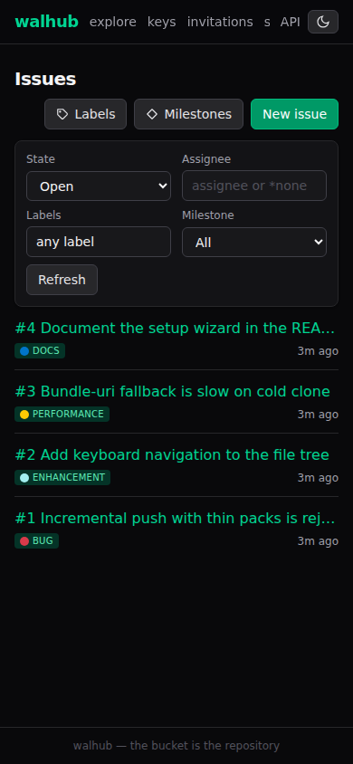 | **Issues at 390 px.** Same measurement, same result. |

### 2.3 What the current UI does well

- The dark theme is genuinely pleasant: near-black canvas, `zinc-900/70` surfaces, hairline borders,
  no glare. It reads as a tool, not a toy.
- Navigation is predictable: one header, one tab strip, one column. Nothing moves between pages.
- The settings page is the strongest screen — the vertical section nav with a filled active row and a
  separate "Danger zone" gives the page a shape the content pages lack.
- Server-rendered pages are fast and honest: empty states say what to do next, the commit list carries
  author + age + SHA + parent, the README panel switches between rendered docs without a client router.
- Mobile already holds: tabs and nav scroll internally, the document never pans.

### 2.4 What holds it back

1. **One accent, no meaning.** Emerald marks the wordmark, nav hover, every link, every primary
   button, the active tab, file names and SHAs. When everything interactive is the same colour,
   colour stops carrying information — you cannot see at a glance whether you are looking at code,
   issues, or infrastructure.
2. **One surface, no hierarchy.** Every region is the same `rounded-lg border shadow-sm` card. The
   page has no foreground/background relationship, so the eye has no entry point.
3. **The Code page omits what developers need.** No branch selector (just a static chip), no "go to
   file", no visible clone URL (only a `Clone` button), no commit message or CI state per row, no
   repository *About* panel and no activity. The content is one full-width stack — table then README —
   and it ends two-thirds of the way down a 1440×900 viewport with nothing beside it.
4. **The file table leads with Unix modes.** `drwxr-xr-x` / `-rw-r--r--` occupy the first column; the
   name sits in the middle; sizes are 12 px. It is authentic but it inverts the reading order.
5. **The Issues page is a form, not a workspace.** State is a `<select>`, and the filter card carries a
   `Refresh` button — an operator's control on a reader's page. Rows have no author, no comment count,
   no label rail, no state tabs, so triage means opening each issue.
6. **Explore has no density story.** One owner card floating in a 1440×900 canvas; there is no recent
   activity, no repository cards, nothing that says "this instance is alive".
7. **Flat typography.** Almost everything is 14 px. Titles are 18–20 px with the same weight as body
   labels; metadata is the same size as content. There is no display weight, no editorial hierarchy.
8. **Top-level nav is developer plumbing.** `explore · keys · invitations · setup` sit at the same
   level as everything else, with no search and no create affordance.

---

## 3. Proposals

Each proposal is a self-contained HTML mock (sources in `docs/design/mocks/`), rendered at 1440 px
wide — 900 px tall for the Issues list, 1200 px for the Code page so the README panel is visible. The
mocks are not pixel specs — they exist to make the language tangible and to argue about the *idea*
before writing any template.

### 3.1 A — “Precision Dark” (terminal-native)

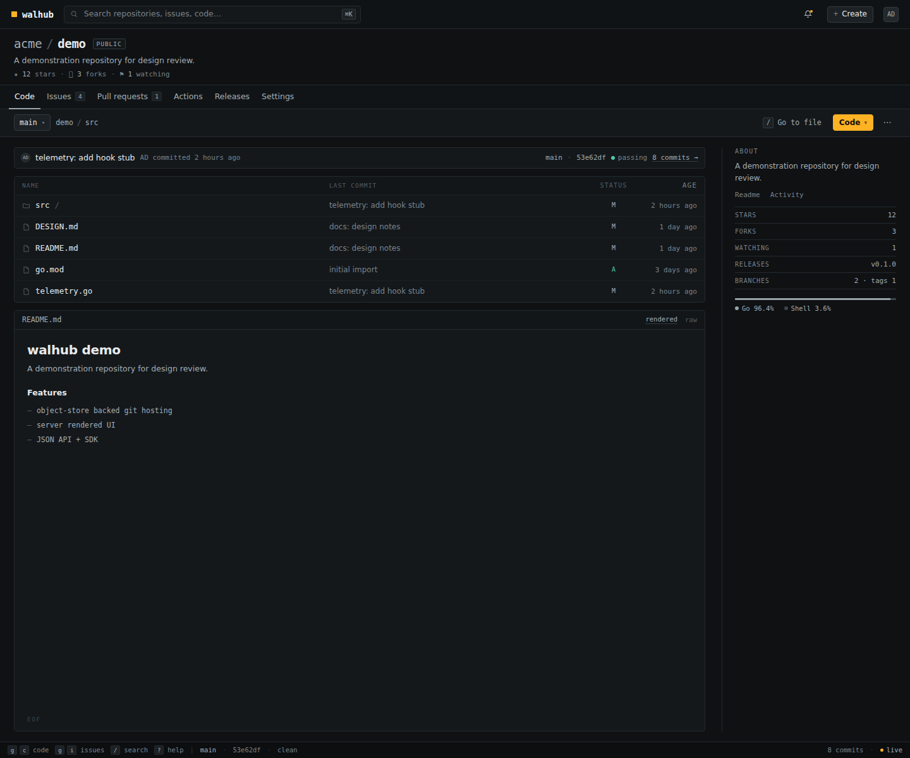

**Thesis.** A tool for people who live in it: maximum signal per pixel, monospace for every
identifier, keyboard paths everywhere, and one amber accent that means *action* rather than *link*.

**What changes**

- Surfaces go from zinc to graphite (`#0f1113` / `#14181b` / `#1c2125`) with 2–4 px radii — no
  rounded-lg cards, no shadows. Depth comes from surface steps and hairlines.
- **Monospace is the identity**: branch, path breadcrumb, SHAs, commit ages, the status bar — all
  monospace. Prose stays in the sans stack, so the page has two clear voices instead of one.
- Amber (`#ffb224`) is the only accent and it appears on the primary action (`Code` clone), the active
  branch, and the focus ring. Links are text-coloured with a subtle underline on hover.
- The Code page gains a **commit strip** (`main · 53e62df · ● passing · 8 commits ›`), a **STATUS
  column** (`M`/`A` change glyphs), a **`Go to file`** shortcut hint and a compact key/value **About**
  rail.
- A **status bar** pins to the bottom of the viewport: `g c` code · `g i` issues · `/ search` · `? help`
  · `main` · `53e62df` · `clean`, with `8 commits · ● live` on the right. This is the strongest single
  differentiator: it makes the product feel operated rather than browsed.
- The README panel gets `rendered | raw` and an `EOF` marker — a code-viewer idiom applied to docs.
- Issues rows are single-line, dense: state glyph, number, title, label chip, right-aligned activity.
  Triage is scanning, not reading.

**Tokens**

| Role | Value |
|---|---|
| Canvas / surface / raised | `#0f1113` · `#14181b` · `#1c2125` |
| Border / strong border | `#232a2e` · `#323a3f` |
| Text / secondary / muted | `#e6eaec` · `#a3adb4` · `#79838b` |
| Accent (action only) | `#ffb224` (hover `#ffc862`), ink on accent `#151004` |
| State | `#4ec9a4` pass · `#9d8cff` merged · `#e06c6c` fail |
| Radius | 2 / 4 px |
| Type | sans for prose; mono for every identifier; 9.5–13.5 px metadata, 19–20 px titles |
| Rhythm | 4 pt base, 34 px rows, 8 px gutters inside cards, 46 px top bar, 26 px status strip |

**Costs.** Density is a choice with a real price: 34 px rows and 9.5–13.5 px type are hostile to
casual users, and the status bar plus key hints are dead weight on touch. An amber-on-graphite scheme
is a strong brand commitment — it reads "developer tool", which narrows the audience it flatters.
Monospace everywhere can also make a page feel like a debug console if used for prose by accident.

**Mobile treatment.** The status bar and key hints disappear (`@media (pointer: coarse)`); rows grow to
44 px; the About rail collapses under the file table; the commit strip keeps message + age and drops
the SHA; the STATUS column is dropped.

### 3.2 B — “Soft Light” (editorial)

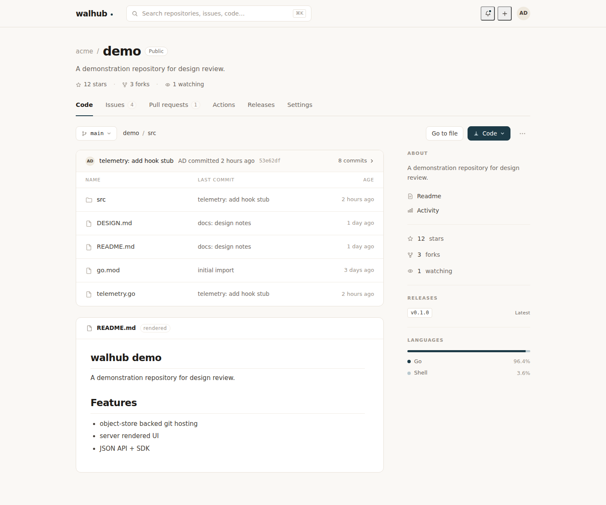

**Thesis.** Reading is the primary job. Calm paper surfaces, a real typographic scale, and colour
reserved for state rather than decoration.

**What changes**

- Canvas becomes warm off-white (`#FAF8F5`); surfaces are white defined by a 1 px warm hairline —
  no shadows anywhere, so hierarchy is carried by type and spacing rather than elevation.
- The repo header is allowed to breathe: `acme / demo` set at display size, description beneath,
  meta (stars/forks/watching) as a quiet inline row, then a single hairline tab strip.
- The Code page gains the four things the current page lacks: a **branch pill**, a **commit summary
  strip** (latest commit message, author, age, short SHA, "8 commits ›"), a **`Go to file`** button,
  and an **About rail** with README/Activity, stars/forks/watching, releases and a language bar.
- File rows are 56 px with a real three-column rhythm (`name`, `last commit`, `age`); the Unix mode
  column is gone, sizes are demoted to the age column, and the file icon replaces the mode text.
- The README is set at a ~68-character measure with 1.68 leading — the page reads like a publication
  rather than a form.
- Issues rows are two-line: title at 17 px, then `#41 opened 1 day ago by jane · 2 comments` at 13 px
  muted; labels are outlined pills with a state dot, not filled blocks.

**Tokens**

| Role | Value |
|---|---|
| Canvas / raised / sunken | `#FAF8F5` · `#FFFFFF` · `#FCFAF7` |
| Hairline / soft rule | `#E8E1D7` · `#F1ECE4` |
| Text primary / muted / faint | `#1E1B18` · `#6E675F` · `#9C948B` |
| Action accent | `#1D3B47` deep ink (+ `#CFE0E5` tint) |
| State | `#2F7A55` open · `#6A4C93` merged · `#9C6C18` draft · `#9E4634` bug |
| Radius | 4 / 8 / 12 / pill |
| Type | 11 eyebrow · 12.5 mono id · 13 meta · 15 body · 17 row title · 23 section · 30 display |
| Rhythm | 4 pt base, 40 px gutter (1160 max), 56 px row |

**Costs.** Light-first means the dark theme becomes a second translation (and the shipped UI is
dark by default — a light-first identity is a reversal of the product's current character). No
shadows and few containers means dense pages rely entirely on spacing discipline; get the rhythm
wrong and the page looks unfinished rather than minimal. Display type on technical identifiers
(repo names, branches) can read as marketing if the weight is overdone.

**Mobile treatment.** One column: repo header collapses to breadcrumb + description; the tab strip
scrolls; the About rail moves below the README as a ruled list; the file table drops the last-commit
column and keeps name + age; issue rows keep two lines.

### 3.3 C — “Layered Depth” (spatial)

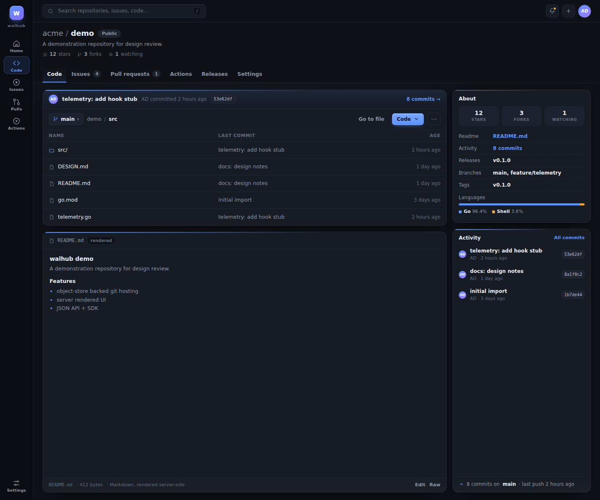

**Thesis.** An application, not a document: a persistent icon rail for where you are, layered cards
for what you are looking at, and a colour per functional area so the product is legible from
peripheral vision.

**What changes**

- An 80 px **icon rail** on the left with labels (Home, Code, Issues, Pulls, Actions, Settings) and an
  active pill in the area's own colour. The rail is always present, so the app has a stable frame.
- **Colour becomes functional, one hue per area**: code `#5B93FF`, issues `#F0A63C`, pull requests
  `#A47BFF`, actions `#3FD68F`, settings slate `#7C879B`. The same hue marks the rail item, the tab,
  the card's top edge and the section icon — so "where am I" is answered by colour before reading.
- The Code page is a **bento**: a wide files card, an About card whose stats are three tiles
  (`12 stars / 3 forks / 1 watching`) with a language bar, and an Activity card listing three recent
  commits with author chips and SHAs.
- The commit strip is inside the files card rather than above the layout, so the card reads as one
  object: `message · author · age · SHA` on the left, `8 commits →` on the right.
- Issues are **individual cards** with a 3 px left edge in the primary label's colour, a comment-count
  chip on the right, a segmented Open/Closed control, and a sidebar with label counts, a milestone
  **progress ring** (`44% closed`, 4 of 9) and assignee filters.
- Radius 6/8/12, layered shadows (`0 1px 2px` + a long soft drop), 16–20 px gutters between cards.

**Tokens**

| Role | Value |
|---|---|
| Canvas / rail / surface / raised / raised-2 | `#0F1117` · `#0A0C11` · `#171B24` · `#1D2230` · `#232937` |
| Border / soft border | `#262C3A` · `#1F2431` |
| Text / muted / faint | `#E9EDF5` · `#8A93A6` · `#616B7E` |
| Area hues | code `#5B93FF` · issues `#F0A63C` · pulls `#A47BFF` · actions `#3FD68F` · settings `#7C879B` · alert `#F8708A` |
| Radius | 6 / 8 / 12 / pill |
| Elevation | `0 1px 2px rgba(0,0,0,.45), 0 16px 38px -26px rgba(0,0,0,1)` |
| Type | sans UI, mono only for refs/SHAs; 11 caps labels, 13 meta, 14–15 body, 17–20 titles |

**Costs.** The rail and the repo tab strip are two navigation systems, and in the mock they duplicate
each other (Code/Issues/Pulls/Actions appear twice). It only works if the rail holds *cross-repo*
destinations ("my work": inbox, assigned issues, review queue) and the tab strip stays repo-scoped —
otherwise the frame is noise. Per-area colour is a one-way commitment: seven hues must stay
distinguishable in both themes and must not collide with label colours (the issue cards already put
`bug` red next to the issues amber). Layered shadows on every card also fight the density that a code
host needs; they work on the bento dashboard and should be dropped inside the file table.

**Mobile treatment.** The rail becomes a bottom tab bar (five items max) with the same area colours;
cards go full-bleed with a 12 px gutter; the About and Activity cards stack under the files card; the
issue sidebar becomes a filter sheet opened from a `Filter` chip.

## 4. Side by side

### 4.1 Repository → Code

| Current | A — Precision Dark |
|---|---|
| 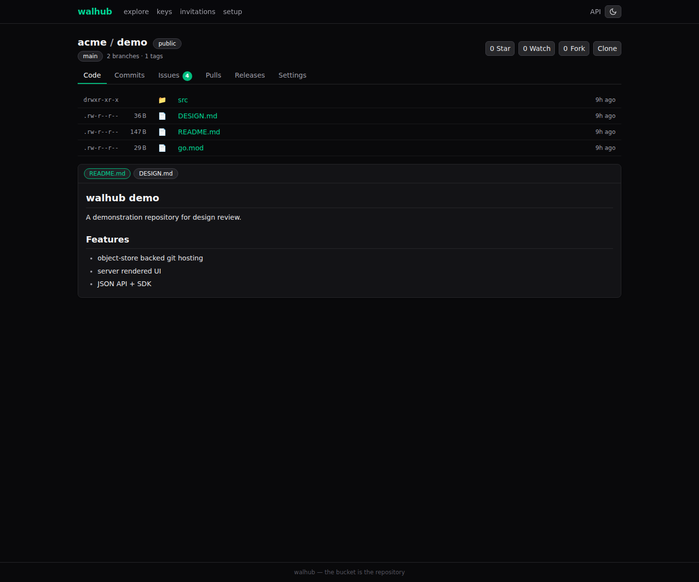 |  |
| **B — Soft Light** | **C — Layered Depth** |
|  |  |

| Dimension | Current | A | B | C |
|---|---|---|---|---|
| Frame | one header, one column | one header + status bar | one line header, one column + rail | icon rail + cards |
| What colour means | "clickable" | "action" | "state" | "area" |
| Code page composition | file table + README | commit strip, STATUS column, table, README, About | commit strip, branch/`Go to file`, table, README, About | files card (strip inside), About tiles, Activity card |
| Branch control | static chip | branch pill in strip | branch pill in toolbar | branch pill in toolbar |
| Row height | ~40 px | 34 px | 56 px | 44 px |
| Identity | neutral admin | operated tool | publication | application |

### 4.2 Repository → Issues

| Current | A — Precision Dark |
|---|---|
|  | 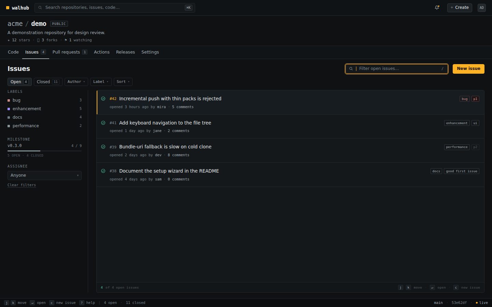 |
| **B — Soft Light** | **C — Layered Depth** |
| 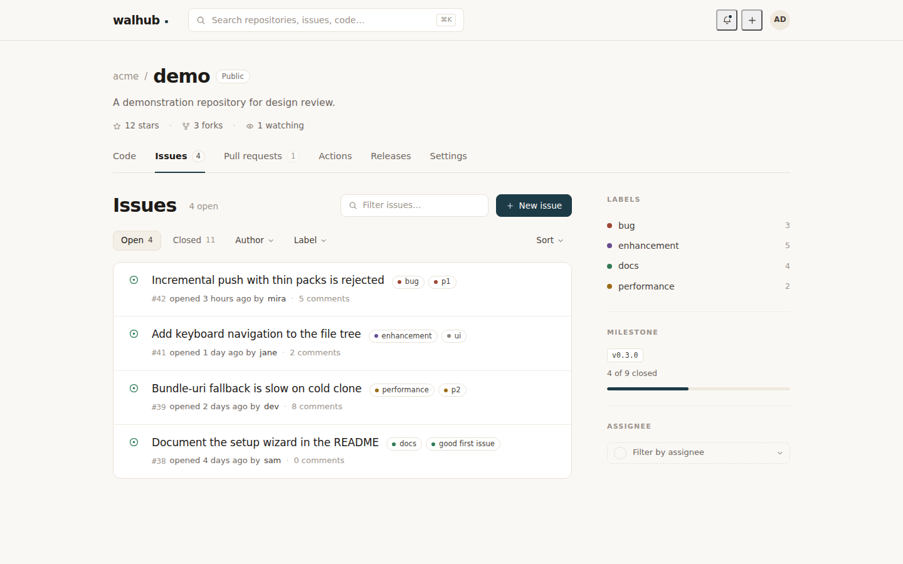 | 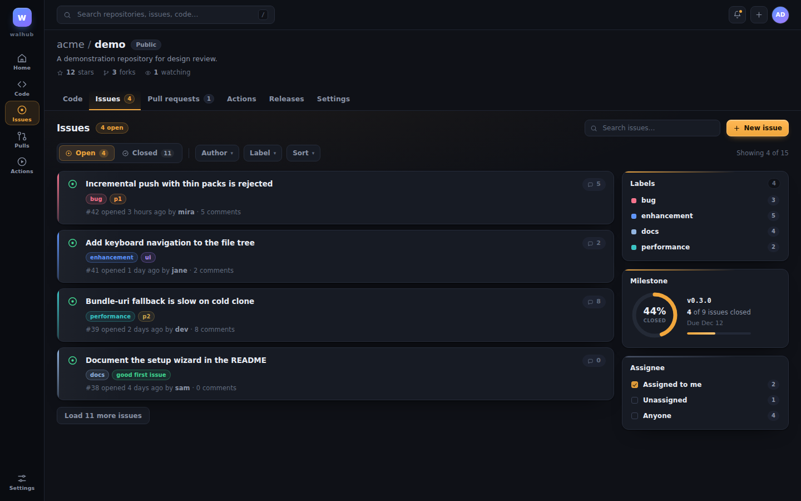 |

| Dimension | Current | A | B | C |
|---|---|---|---|---|
| State filter | `<select>` + `Refresh` | pills (Open/Closed) + key hints | segmented pills | segmented control with counts |
| Row content | number, title, label, age | glyph, number, title, labels, activity | two lines: title + `#n opened … by … · n comments` | card: title, labels, meta, comment chip |
| Triage aid | none | label rail with counts, milestone `4 / 9` | label rail, milestone bar, assignee filter | label rail, milestone ring `44%`, assignee filters |
| Page furniture | filter card | left rail + footer count + status bar | toolbar + rail | toolbar + card grid |

### 4.3 Functional differentiation — the actual test

The brief was to *differentiate functionality*. Put plainly: can a user tell, without reading the
title, whether they are in code, issues, pull requests or operations?

| | Answer |
|---|---|
| **Current** | No. Every area is the same zinc column with an emerald link; only the tab underline differs. |
| **A** | Partly. The shape tells you it is a repository surface (file table vs. list), and the status bar tells you the product is live, but all areas share the same amber voice. |
| **B** | No, by design. Areas are differentiated by type scale and row rhythm, which is elegant but not pre-attentive — you still read the heading. |
| **C** | Yes. Each area owns a hue that repeats on the rail, the tab, the card edge and the page icon; the issues page is amber, code is blue, pulls are violet, actions are green. This is the only proposal that answers the brief directly. |

---

## 5. Recommendation

**Adopt C as the design language, with two deliberate borrowings from A and one from B.**

Why C:

1. **It answers the brief.** Functional differentiation is only pre-attentive in C; A differentiates
   *screens* (dense vs. sparse) and B differentiates *nothing* — it makes everything calm, which is
   the opposite of differentiation.
2. **It is buildable incrementally on what exists.** The rail is one shared partial; the cards are
   the existing `.card` class with a per-area custom property; the bento is a CSS grid. No client-side
   router, no new dependency (AGENTS law 1), and the server-rendered templates keep working page by
   page — the rail can land first, then the Code bento, then Issues.
3. **It gives the product a frame.** The current UI has no persistent spatial anchor; every page is a
   fresh column. A rail plus area colour makes navigation recognizable at a glance, which is what
   "best of breed" looks like in this category.

Borrow from A:

- **Monospace for identifiers** (refs, SHAs, paths, counts) — it is what makes spindle look like it
  takes git seriously, and it survives inside C's bento.
- **Density inside code surfaces**: 34 px rows and the `STATUS` column for the file table, while
  keeping C's card frame around it. Drop A's global status bar — it duplicates information and steals
  vertical space.

Borrow from B:

- **The README measure.** B's ~68-character, 1.68-leading reading column is the single best detail in
  the set; C's card otherwise stretches prose to 900 px.

Refinements C needs before it ships (found by building it):

1. **De-duplicate navigation.** The rail must be *cross-repo* ("my work": inbox, assigned issues,
   review queue, notifications) and the tab strip stays repo-scoped. The mock's rail mirrors the
   repo tabs, which would ship two ways to do the same thing.
2. **Keep label colours and area colours in separate value ranges.** Issue cards must not put label
   red adjacent to area amber at the same saturation; labels get tinted backgrounds, areas get edges.
3. **No elevation inside tables.** Layered shadows belong to the bento and the rail; the file table
   and issue list keep hairlines, or density suffers.
4. **Contrast.** Every area hue on its tinted surface must hold ≥ 4.5:1 for text and ≥ 3:1 for the
   3 px edges, in both themes. This is the main accessibility risk of the direction.

If the appetite is instead "ship the smallest thing that makes it look modern", the answer is A: it
is the cheapest to build (no layout restructure), it is unambiguously differentiated, and it flatters
the developer audience the product already has. B is the most beautiful and the least strategic: it
makes spindle look like a well-made documentation site, which is not what a git host should look like.

---

## 6. If this is adopted

- `docs/style-guideline.md` §1 (Foundations) is rewritten with the chosen tokens, and §3/§6/§8 get new
  canonical references (the issues list and the code table are the two reference pages). Per AGENTS,
  the change lands with an amendment in the guideline's Decisions section in the same commit.
- `web/src/app.css` gains the token layer (`--area-code`, `--area-issues`, …) and the component
  classes; the existing `.card`, `.site-header`, `.chip` vocabulary is retuned rather than replaced.
- Templates change page by page behind the existing page-provider seam: the rail partial and the
  chrome first, then `pages/repo/tree.html`, then `pages/collab/issues.html`, then the rest.
- Every step keeps the current bars: no page-level horizontal pan at 390 px, server-side rendering for
  all user content, no new dependency, and the same request budget (the rail adds no round trip).

---

## 7. Defects observed while preparing this document

Real findings from running a populated instance; they are tracked separately from the design work.

1. **The Code page 404'd on every real repository** (fixed in `1fa3a62`). `walView.Tree` never sets
   `Ref`/`SHA` — only the API's tree handler fills them — so the page's root README fetch passed an
   empty SHA. The webui test fakes populated the fields, which is why the gate stayed green. The page
   now reads `Ref`/`SHA` from its own `Resolve`, and `repoViewError` logs the underlying error when
   `SPINDLE_DEBUG_PAGE=1`.
2. **Incremental pushes carrying cross-pack deltas are rejected** with
   `remote: pack rejected: fatal: pack has N unresolved delta`. Reproduced on a normal branch push
   after a repack; worked around for the seed with `git -c pack.window=0 -c pack.depth=0 push
   --no-thin`. This is an ingest bug, not a client problem — `git push` must accept what stock git
   produces.
3. **`1 tags`** — the repository meta line does not pluralise (`2 branches · 1 tags`).
4. **`Refresh` in the Issues filter card** — a manual reload control on a page that already renders
   fresh; it is an operator's affordance in a reader's flow.
5. **`internal/repoimport` `TestEvidenceImportFlat` failed only in CI** (fixed in `7d2558f`) — the
   single-pack fixture assertion globbed a hard-coded pack directory, so a layout git did not choose
   read as "zero packs". The test now resolves the directory through `git rev-parse --git-path`.

---

## 8. After — the shipped result

Direction A implemented on `feat/precision-dark` (see `docs/style-guideline.md` §1 for the
normative rules). Same instance, same data as the baseline captures above.

| | |
|---|---|
| 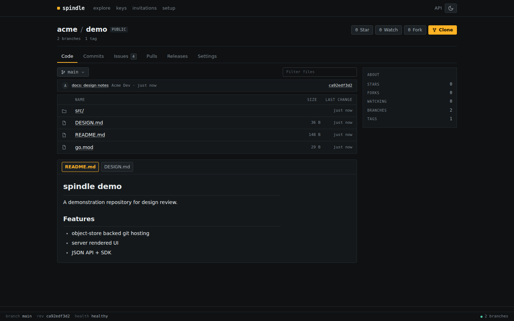 | 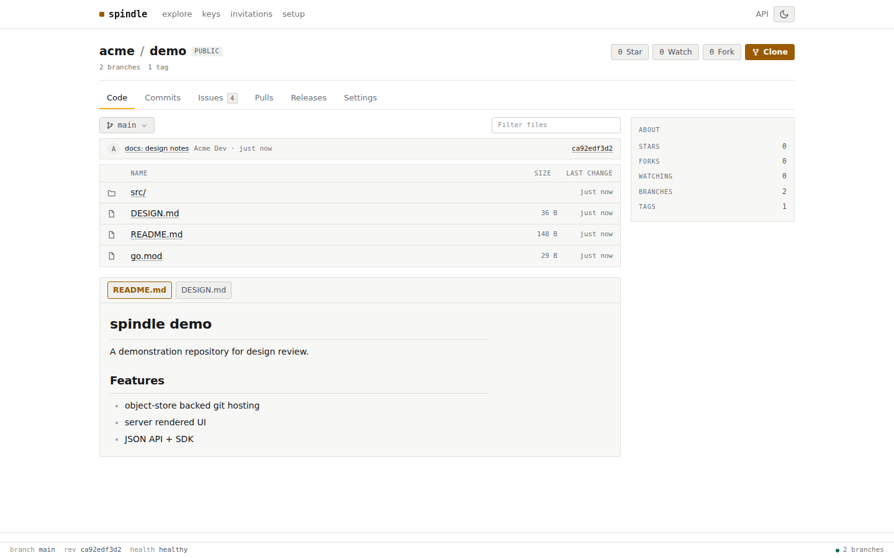 |
| **Repository → Code** (dark): branch selector, commit strip, About rail, status strip. | **The same page in light** — the deep-amber action colour holds 5.4:1 on white. |

| | |
|---|---|
| 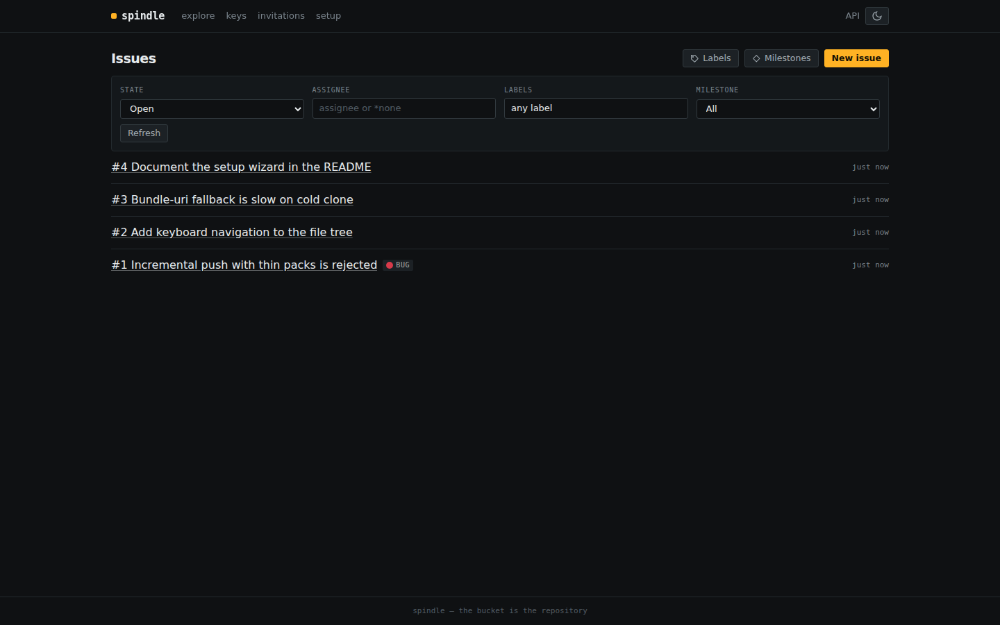 | 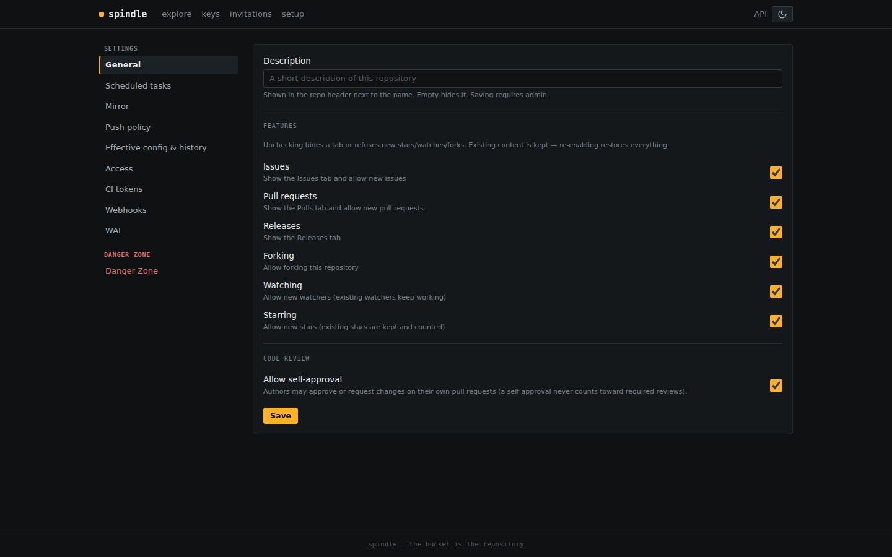 |
| **Issues**: micro-caps filter labels, one amber CTA, mono timestamps. | **Settings**: the active section carries an amber edge, not a fill. |

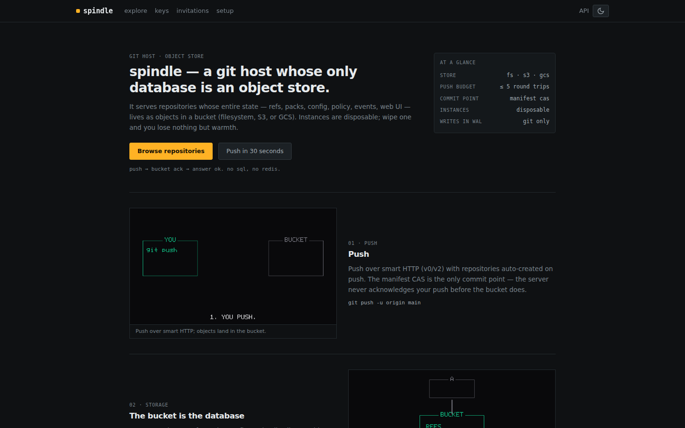

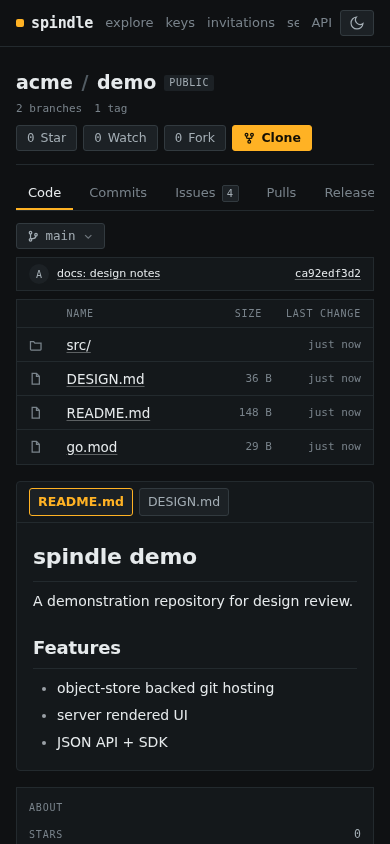

The Code page at 390 px: title and actions stack, the toolbar keeps the branch selector and
breadcrumb, the table scrolls inside its own wrapper, and the About rail moves below the content.
Measured `scrollWidth == clientWidth` on every page in both themes.
